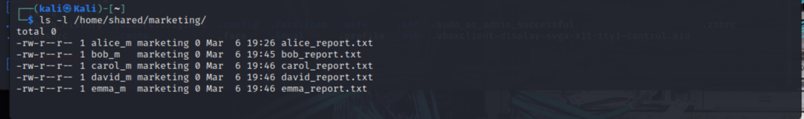

# Linux-Commands-User-Management-Lab
# Lab Title: User Management in Linux

## Objective
The goal of this lab was to practice creating users, assigning them to groups, and managing file permissions in a Linux environment.

## Tools Used
* Kali Linux (Virtual Machine)
* Terminal (Bash)

## Scenario 
You are the system administrator for TechCorp Solutions, a growing technology company. You need to set up user accounts and file permissions for two departments: 

## Part 1: Marketing Department (Individual User Files)
The Marketing department has 5 new employees joining the team. Each employee needs their own workspace with private files that only they can access.

## Step-by-Step Process & Commands Executed - 
1. **Created a new group:**

   `sudo groupadd marketing`
   
2. **Created 5 users with the following usernames: alice_m, bob_m, carol_m, david_m, emma_m**

   `sudo adduser alice_m`

   `sudo adduser bob_m`

   `sudo adduser carol_m`

    `sudo adduser david_m`

   `sudo adduser emma_m`
   
3. **Added 5 users to the group**
   
   `sudo usermod -aG marketing alice_m`

   `sudo useradd -aG marketing bob_m`

   `sudo useradd -aG marketing carol_m`

   `sudo useradd -aG marketing david_m`

   `sudo useradd -aG marketing emma_m`
   
4. **Set up the shared directory:**
   
   `sudo mkdir -p /home/shared/marketing`
   
5(a). **Created a personal file for each user in /home/shared/marketing/: i.e alice_m → alice_report.txt**

   `sudo touch /home/shared/marketing/alice_report.txt`
   `sudo touch /home/shared/marketing/bob_report.txt`
   `sudo touch /home/shared/marketing/carol_report.txt`
   `sudo touch /home/shared/marketing/david_report.txt`
   `sudo touch /home/shared/marketing/emma_report.txt`
 (b). **Created the assigned ownership of personal file.(Each user will be the owner of the corresponding file)**
   `sudo chown alice_m:marketing /home/shared/marketing/alice_report.txt`
   `sudo chown bob_m:marketing /home/shared/marketing/bob_report.txt`
   `sudo chown carol_m:marketing /home/shared/marketing/carol_report.txt`
   `sudo chown david_m:marketing /home/shared/marketing/david_report.txt`
   `sudo chown emma_m:marketing /home/shared/marketing/emma_report.txt`
9. **Set permissions to {700}**
   `sudo chmod 700 /home/shared/marketing/alice_report.txt`
   `sudo chmod 700 /home/shared/marketing/bob_report.txt`
   `sudo chmod 700 /home/shared/marketing/carol_report.txt`
   `sudo chmod 700 /home/shared/marketing/david_report.txt`
   `sudo chmod 700 /home/shared/marketing/emma_report.txt`
   
## Deliverables-
1. **Verified all users created using cat**
   `cat /etc/passwd`
   
3. **Verified group marketing using getent**
   `getent group marketing`
   
5. **Verified all files created in their respective directories (use ls -l)**
    `ls -l /home/shared/marketing/`
   
7. **Verified correct permissions set on all files (use ls -l to show permission strings)**
    `ls -l /home/shared/marketing/` 
   

## Key Observations / Lessons Learned
* I learned that even though the files are under a common directory (/home/shared/marketing/), setting group and other permissions to zero ensures that Alice cannot read Bob's report, and Carol cannot modify Emma's. 
* I learned that when a system administrator (usually root) creates files on behalf of users, the files are initially owned by the root.
*Using the chown command, it hands over ownership to the respective employees. Without this step, the 700 permissions would lock the employees out of their own files.

  
## Part 2: IT Department (Shared Group File)
The IT department needs a collaborative workspace where all team members can work on a shared project file together. 

## Step-by-Step Process & Commands Executed - 
1. **Created a new group:**
   `sudo groupadd itdept`
2. **Created 5 users with the following usernames: frank_it, grace_it, henry_it, iris_it, jack_it**
   `sudo adduser frank_it`
   `sudo adduser grace_it`
   `sudo adduser henry_it`
   `sudo adduser iris_it`
   `sudo adduser jack_it`
3. **Added 5 users to the group**
   `sudo usermod -aG itdept frank_it`
   `sudo useradd -aG itdept grace_it`
   `sudo useradd -aG itdept henry_it`
   `sudo useradd -aG itdept iris_it`
   `sudo useradd -aG itdept jack_it`
4. **Set up the shared directory:**
   `sudo mkdir -p /home/shared/itdept`
5. **Created one shared file in /home/shared/itdept/:i.e project_specs.txt**
   `sudo touch /home/shared/itdept/project_specs.txt`
6. **Set ownership and permissions**
(a). **Changed the ownership so the itdept group owns the file**
   `sudo chown :itdept /home/shared/itdept/project_specs.txt`
(b). **Set permissions to {770}**
   `sudo chmod 770 /home/shared/itdept/project_specs.txt`
   
## Deliverables-
1. **Verified all users created using cat**
   `cat /etc/passwd`
   
3. **Verified group marketing using getent**
   `getent group itdept`
   
5. **Verified all files created in their respective directories (use ls -l)**
    `ls -l /home/shared/itdept/`
   
7. **Verified correct permissions set on all files (use ls -l to show permission strings)**
     `ls -l /home/shared/itdept/`
   

## Key Observations / Lessons Learned
* I learned that instead of assigning file permissions to Frank, Grace, Henry, Iris, and Jack individually, adding them to an itdept group centralizes control. If a team member leaves or joins, you only need to update the group membership, rather than modifying file permissions across the system.
* I learned that users will not be able to access the file if they don't have the correct permissions on the parent directories.
* Setting the permission of others to zero demonstrates the principle of least privilege. Project specifications are very sensitive, and denying access to anyone outside the itdept group prevents unauthorized viewing or tampering by other users on the system.

   
   
